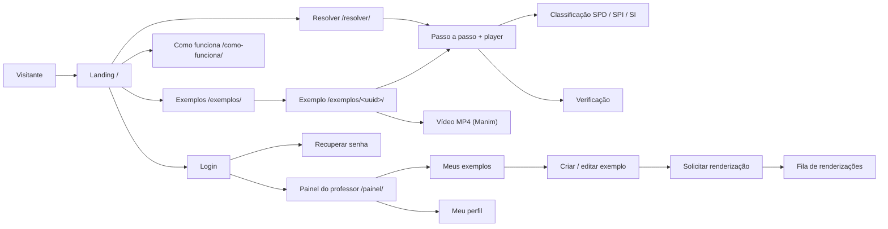

# PROJECT_SPEC.md — Especificação do Projeto/Produto (PRD + TRD mínimo)

**Projeto:** `algebra_linear` — produto **Álgebra em Cena**  
**Versão do modelo:** 3.1 (alinhada ao `AGENT_INSTRUCTIONS_DJANGO.md` v3.1)  
**Versão deste documento:** 0.2 (preenchimento inicial, 2026-11-09)  
**Ambiente:** WSL 2 (Ubuntu) em `~/projetos/django/algebra_linear/`  
**Diretriz superior:** `AGENT_INSTRUCTIONS_DJANGO.md` (Doc ①)  
**Posição no padrão:** Documento ② de 3 — o **mínimo geral** do projeto/produto, ponto de partida para as especificidades do aplicativo.

> Itens marcados **[CONFIRMAR]** são suposições do preenchimento inicial que precisam de validação do responsável pelo produto.

---

## 0. Como Usar Este Documento

### 0.1. Papel

Este documento reúne:

- o **PRD** (Documento de Requisitos do Produto): visão, perfis, escopo, AppFlow, landing page e briefing de design (§1–§6);
- o **TRD mínimo do projeto** (Documento de Requisitos Técnicos): topologia, dados, autenticação, parâmetros e testes (§7–§11);
- a **governança** do projeto: Definition of Done, decisões (ADR) e changelog (§12–§14).

### 0.2. O que NÃO repetir aqui

Tudo o que o Doc ① já define (ambiente, Git, baseline de segurança, mecanismos de RBAC, CSP, rate limit etc.) **não é copiado**. Aqui se registra apenas:

- o **valor** próprio do projeto;
- a **exceção** justificada a uma regra do Doc ① (§10);
- o que depende de **produto, público, marca, dados ou negócio**.

Onde estiver **[PADRÃO]**, vale o Doc ① sem alteração.

### 0.3. Mapa de domínios deste documento

| Domínio | Seções | Conteúdo |
| :--- | :--- | :--- |
| **PRODUTO (PRD)** | §1–§6 | Visão e escopo; AppFlow e onboarding; landing e páginas públicas; briefing de design e tema; menus; perfis e matriz RBAC. |
| **PROJETO TÉCNICO (TRD mínimo)** | §7–§11 | Topologia; dados e identificadores; autenticação e integrações; parâmetros e exceções de segurança; testes. |
| **GOVERNANÇA** | §12–§14 | Definition of Done; registro de decisões; changelog. |
| **ANEXOS** | A–C | Casca fina, `base.css` e context processor do tema; `.env.example`; checklist de preenchimento. |

### 0.4. Documentos do projeto

| Arquivo | Conteúdo |
| :--- | :--- |
| `PROJECT_SPEC.md` | Este documento. |
| `regras_de_negocio.md` | **Exclusivo** de regras de negócio (RN) e requisitos funcionais (RF) detalhados: motor de cálculo, classificação, convenção de cores, trace, exemplos e renderização. Nenhuma RN é duplicada neste documento. |
| `apps/<app>/README.md` | Documentação individual de cada app (Doc ① §9.3). |
| `render/remotion/README.md` | Subprojeto Node do player Remotion (EXC-001). |
| `ARCHITECTURE.md` · `DATABASE.md` · `API.md` · `TESTING.md` · `SECURITY.md` | Opcionais; só quando o conteúdo não couber aqui. |

---

# PARTE I — DOMÍNIO: PRODUTO (PRD)

---

## 1. Visão e Escopo

### 1.1. Identificação

| Item | Valor |
| :--- | :--- |
| Nome do produto | **Álgebra em Cena** |
| Descrição em uma frase | Resolve sistemas lineares 2×2 e 3×3 passo a passo, com animações que destacam em cores as linhas e as colunas substituídas, e classifica o sistema como SPD, SPI ou SI. |
| Cliente / patrocinador | Oscar — projeto pessoal/acadêmico de Álgebra Linear **[CONFIRMAR]** |
| Público final | Estudantes de ensino médio e graduação que estudam sistemas lineares; professores que preparam exemplos e vídeos de aula. |
| Status | Rascunho |

### 1.2. Problema e objetivos

Resolver um sistema por Cramer ou por escalonamento no caderno exige muitas contas intermediárias, e é fácil errar qual coluna trocar por K (ex.: montar o Dz transposto) ou concluir "SPI" só porque D = 0. O produto mostra cada transformação, com cores fixas por incógnita, e confere o resultado.

| Objetivo | Indicador de sucesso |
| :--- | :--- |
| Tornar visível cada passo da regra de Cramer e do escalonamento | 100% dos casos de referência do caderno (§11) reproduzidos passo a passo, com o mesmo resultado |
| Classificar corretamente qualquer sistema 2×2 ou 3×3 | Classificação SPD/SPI/SI correta em 100% da suíte de testes, incluindo os contraexemplos de D = 0 |
| Permitir uso imediato, sem cadastro | Visitante resolve um sistema em até 3 interações (informar, resolver, avançar) |
| Gerar material de aula reutilizável | Professor gera vídeo MP4 (16:9 ou 9:16) de um exemplo sem escrever código |

### 1.3. Perfis de usuário (visão de produto)

| Perfil | Interno/Externo | Objetivo principal | Canal |
| :--- | :-: | :--- | :--- |
| Visitante (anônimo) | Externo | Informar um sistema e estudar o passo a passo animado; ver exemplos e vídeos publicados | Web (desktop e mobile) |
| Professor | Interno | Cadastrar exemplos e problemas contextualizados, publicar na galeria e solicitar vídeos Manim | Web |
| Administrador | Interno | Gerenciar professores, tema, visibilidade pública e fila de renderização | Web |
| Desenvolvedor | Interno | Manutenção técnica e suporte | Web |

> Os códigos, a ordem de privilégio e a matriz de permissões ficam na §6.

### 1.4. Escopo

| Dentro do escopo (v1) | Fora do escopo (v1) |
| :--- | :--- |
| Sistemas quadrados 2×2 e 3×3 | Sistemas não quadrados (m ≠ n) e ordem ≥ 4 (Laplace) — candidatos à v2 |
| Coeficientes inteiros, decimais e frações, com aritmética exata | Coeficientes simbólicos (letras, parâmetros k) |
| Regra de Cramer: 2×2 (produto cruzado) e 3×3 (Sarrus), com D, Dx, Dy, Dz | Matriz inversa, decomposição LU, autovalores |
| Escalonamento (Gauss) com operações elementares exibidas | Contas de aluno, turmas, listas e exercícios avaliados |
| Classificação SPD / SPI / SI por posto, solução geral paramétrica no SPI | Interpretação automática de enunciados em texto (o professor informa o sistema) |
| Verificação da solução por substituição | Renderização de MP4 pelo Remotion no servidor |
| Passo a passo na web e player Remotion com os valores do visitante | Login social (OAuth) |
| Exemplos e problemas contextualizados cadastrados pelo professor; galeria pública | Aplicativo móvel nativo |
| Vídeos MP4 gerados pelo Manim (16:9 e 9:16) | Multi-tenant |

Premissas e restrições:

- **Sem dados pessoais de visitantes:** o resolver não persiste nada; o link compartilhável carrega o sistema na *querystring*.
- **Remotion** exige Node.js no WSL, contrariando o Doc ① §11.4: aprovado como exceção **EXC-001** (§10.2) e **ADR-003**.
- **Licença do Remotion:** gratuita para pessoa física, organizações sem fins lucrativos e empresas com até 3 funcionários; uso por empresa maior exige licença comercial. Revalidar antes de qualquer uso comercial **[CONFIRMAR]**.
- **Manim** (edição comunitária) exige pacotes de sistema (`ffmpeg`, `cairo`, `pango`, LaTeX) e roda fora do processo web (ADR-004, ADR-005).
- Prazo e orçamento: **[CONFIRMAR]**.

### 1.5. Módulos (apps)

| App | Responsabilidade | Reutilizável? | Depende de | README |
| :--- | :--- | :-: | :--- | :-: |
| `core` | Utilitários transversais, criptografia, resolvedor de tenant, handlers de erro. | Sim | — | ☐ |
| `accounts` | Usuário (UUID), perfis, RBAC, login, reset de senha. | Sim | `core` | ☐ |
| `audit` | Histórico auditável. | Sim | `core` | ☐ |
| `site` | Landing, "Como funciona", perguntas frequentes, páginas de erro, tema (inclui tokens `--mat-*`) e visibilidade pública. | Sim | `core` | ☐ |
| `sistemas` | Motor de cálculo puro (parser, frações, determinantes, Cramer, Sarrus, escalonamento, posto, classificação, verificação), geração do *trace* JSON, resolver público e passo a passo. Sem modelos de banco. | Sim (o pacote `engine/` não depende de Django) | `core`, `site` | ☐ |
| `exemplos` | Exemplos e problemas contextualizados (rascunho/publicado/arquivado), galeria pública. | Não | `core`, `accounts`, `sistemas` | ☐ |
| `animacoes` | Fila de renderização Manim, cenas Manim, armazenamento e entrega dos MP4; ponto de montagem do player Remotion. | Não | `core`, `accounts`, `sistemas`, `exemplos` | ☐ |

Fora de `apps/`: `render/remotion/` (subprojeto Node que gera o bundle estático do player, EXC-001).

### 1.6. Requisitos funcionais

Resumo por módulo, com IDs que apontam para `regras_de_negocio.md`:

| ID | Módulo | Resumo (uma linha) |
| :--- | :--- | :--- |
| RF-001 | `sistemas` | Informar sistema 2×2 ou 3×3 (coeficientes e termos independentes; inteiro, decimal ou fração). |
| RF-002 | `sistemas` | Montar a forma matricial A·X = K e a matriz aumentada [A \| K], com cor fixa por coluna. |
| RF-003 | `sistemas` | Calcular D: produto cruzado (2×2) ou Sarrus (3×3), com diagonais destacadas. |
| RF-004 | `sistemas` | Calcular Dx, Dy, Dz destacando a coluna substituída por K e obter xⱼ = Dⱼ / D. |
| RF-005 | `sistemas` | Resolver por escalonamento, exibindo cada operação elementar com linha pivô e linha alvo. |
| RF-006 | `sistemas` | Classificar em SPD, SPI ou SI por posto e exibir a solução (única, geral paramétrica ou vazia). |
| RF-007 | `sistemas` | Verificar a solução substituindo nas equações originais. |
| RF-008 | `sistemas` | Navegar passo a passo (anterior, próximo, reproduzir) e copiar link compartilhável. |
| RF-009 | `sistemas` | Fornecer o *trace* JSON do sistema (contrato único entre web, Remotion e Manim). |
| RF-010 | `animacoes` | Reproduzir o *trace* no player Remotion embutido, com os valores do visitante. |
| RF-011 | `exemplos` | Professor cadastra exemplo (sistema + enunciado contextualizado opcional + rótulos das incógnitas). |
| RF-012 | `exemplos` | Galeria pública de exemplos publicados, com filtro por ordem, método e classificação. |
| RF-013 | `animacoes` | Professor solicita renderização Manim (16:9 ou 9:16) e acompanha a fila. |
| RF-014 | `animacoes` | Exibir e baixar o MP4 concluído na página do exemplo. |
| RF-015 | `site` | Landing, "Como funciona" (legenda de cores e métodos) e perguntas frequentes. |

### 1.7. Requisitos não funcionais do produto

| Tema | Meta |
| :--- | :--- |
| Desempenho | Resolver e *trace*: p95 ≤ 300 ms no servidor. Passo a passo e player: animações a 60 fps em notebook comum; bundle do player ≤ 400 KB gzip. Renderização Manim 1080p de um exemplo 3×3: ≤ 3 min. |
| Disponibilidade | Sem SLA formal (projeto acadêmico); alvo de 99% em período letivo **[CONFIRMAR]**. A fila de renderização pode ficar indisponível sem afetar o resolver. |
| Acessibilidade | WCAG 2.1 AA; nenhuma informação só por cor (rótulos L1/C1/K e bordas tracejadas); `prefers-reduced-motion` troca animação por transição instantânea; fórmulas em MathML legível por leitor de tela. |
| Navegadores/dispositivos | Duas últimas versões de Chrome, Edge, Firefox e Safari; largura mínima 360 px; projetor de sala (1280×720). |
| Idioma e fuso | `pt-br`, `America/Sao_Paulo`; vírgula decimal na exibição, aceitando vírgula ou ponto na entrada. |
| Retenção de dados | Visitante: nada persistido. Auditoria: 12 meses. Logs técnicos: 90 dias. Vídeos: enquanto o exemplo existir (ver §8.6). |

### 1.8. Marcos e critérios de aceite

| Marco | Entrega | Critério de aceite |
| :--- | :--- | :--- |
| M0 | Bootstrap do projeto (Doc ③), apps do ecossistema, usuário UUID | `check --deploy` sem avisos injustificados; testes de segurança mínimos verdes |
| M1 | Motor de cálculo (`apps/sistemas/engine/`) + *trace* v1 | Casos de referência do caderno e contraexemplos (§11) passando; 100% de cobertura nas funções de classificação |
| M2 | Resolver web passo a passo (sem login) | RF-001 a RF-009; cores conforme RN de cores; teclado e leitor de tela funcionando |
| M3 | Player Remotion embutido | RF-010; bundle estático versionado; compatível com a CSP sem `'unsafe-inline'` |
| M4 | Exemplos e galeria | RF-011 e RF-012; testes de ownership (BOLA) |
| M5 | Vídeos Manim | RF-013 e RF-014; MP4 16:9 e 9:16 dos exemplos do caderno gerados pela fila |
| M6 | Landing, tema T08, onboarding, páginas de erro | RF-015; contraste validado nos temas habilitados |

---

## 2. AppFlow e Onboarding

### 2.1. AppFlow (mapa de navegação por jornada)



| Jornada | Perfil | Entrada | Passos principais | Saída | Rotas |
| :--- | :--- | :--- | :--- | :--- | :--- |
| Resolver um sistema | Visitante | Landing ou link compartilhado | Escolher ordem → informar coeficientes e K → escolher método (Cramer, escalonamento, ambos) → avançar passos → ver classificação e verificação | Solução, link compartilhável | `sistemas:resolver` |
| Estudar exemplo publicado | Visitante | Galeria | Filtrar → abrir exemplo → ler enunciado → passo a passo ou vídeo | Exemplo estudado | `exemplos:galeria`, `exemplos:detalhe`, `animacoes:video` |
| Preparar exemplo de aula | Professor | Painel | Criar exemplo → informar sistema e enunciado → pré-visualizar passo a passo → publicar | Exemplo na galeria | `exemplos:meus`, `exemplos:criar`, `exemplos:editar`, `exemplos:publicar` |
| Gerar vídeo | Professor | Exemplo próprio | Escolher formato (16:9 / 9:16) → solicitar → acompanhar fila → conferir vídeo | MP4 vinculado ao exemplo | `animacoes:solicitar`, `animacoes:fila` |
| Administrar | Administrador | Menu Administração | Convidar professor → atribuir perfil → ajustar tema/visibilidade → monitorar fila | Configuração aplicada | `accounts:matriz`, `site:tema`, `site:visibilidade`, `animacoes:fila` |

### 2.2. Onboarding de navegação

| Perfil | Gatilho | Passos | Saída |
| :--- | :--- | :--- | :--- |
| Visitante | Primeira visita a `/resolver/` | 1) onde informar coeficientes e K; 2) botões de passo; 3) legenda de cores (x, y, z, K, linha pivô/alvo) | Marcado como concluído no navegador (`localStorage`, só um sinalizador sem dado pessoal) |
| Professor | Primeiro login | 1) menu Conteúdo; 2) criar exemplo; 3) pré-visualizar e publicar; 4) solicitar vídeo | Marcado como concluído no usuário |
| Administrador | Primeiro login | 1) menu Administração; 2) convidar professor; 3) fila de renderização | Marcado como concluído no usuário |

Requisitos: pode ser pulado e reaberto; acessível por teclado; **não bloqueia** tarefas; o conteúdo respeita o RBAC (só mostra o que o perfil pode usar); JavaScript em arquivo estático (compatível com a CSP, Doc ① §14).

### 2.3. Estados e feedback

Padronizar estados vazio, carregando, erro e sucesso. Mensagens ao usuário via `django.contrib.messages` (ver `MESSAGE_TAGS`, Anexo A). Estados próprios do produto:

- **Entrada inválida:** erro ao lado do campo (ex.: "Use número inteiro, decimal ou fração, como 3/4"), sem limpar os demais campos.
- **D = 0 no método Cramer:** aviso informativo (não erro): "D = 0: a regra de Cramer não decide. Seguimos pelo escalonamento."
- **Classificação:** selo com cor **e** texto: SPD (sucesso), SPI (atenção), SI (perigo).
- **Fila de renderização:** pendente, renderizando (com tempo decorrido), concluído, falhou (com motivo resumido e botão "Reprocessar").

---

## 3. Landing Page e Páginas Públicas

### 3.1. Papel

Página institucional na rota raiz `/`, **antes do login** (Doc ① §11.1). Apresenta o produto e conduz principalmente ao **Resolver** (ação primária do visitante) e, secundariamente, ao **Login** (professores). Sua exibição é **controlada pelo RBAC** (`site.visibilidade_publica`).

### 3.2. Estrutura

| Seção | Conteúdo | Obrigatória |
| :--- | :--- | :-: |
| Hero | "Veja cada passo do seu sistema linear." + botão **Resolver um sistema** (primário) e **Login** na NAVBAR | Sim |
| Apresentação do produto | O que é: Cramer e escalonamento animados, para estudantes e professores | Sim |
| Benefícios | Cores fixas por incógnita (nunca mais trocar a coluna errada); contas exatas com frações; classificação SPD/SPI/SI explicada; vídeos prontos para aula | Sim |
| Características / Como funciona | 1) Informe o sistema; 2) acompanhe D, Dx, Dy, Dz ou o escalonamento; 3) confira a classificação e a verificação. Demonstração animada estática (GIF/WebM curto) do exemplo 2×2 do caderno | Sim |
| Credibilidade | Exemplos resolvidos (galeria) | Opcional |
| Perguntas frequentes | "Quando a regra de Cramer funciona?"; "D = 0 significa infinitas soluções?" (não necessariamente); "Diferença entre SPD, SPI e SI"; "Posso usar frações?"; "Preciso de conta?" (não) | Sim |
| Chamada final | Botão **Resolver um sistema** | Sim |
| Rodapé | Contato, "Como funciona", política de privacidade (LGPD) | Sim |

### 3.3. Tom e conteúdo

Tom de voz: didático, direto e encorajador, como um monitor paciente; usa a notação de sala de aula (L1, C1, D, Dx, K) e evita jargão sem explicação. Textos dos títulos e chamadas: conforme §3.2; revisão final **[CONFIRMAR]**.

### 3.4. Requisitos técnicos

- Acessível sem autenticação e sem dados privados; quando a visibilidade estiver desativada, as páginas controláveis respondem `404`.
- Sem `style=`/`onclick=` inline; CSS/JS estáticos; compatível com a CSP.
- `title`, `meta description` e Open Graph (imagem: quadro do vídeo de exemplo).
- Responsiva e leve; imagens com `alt`; demonstração animada com alternativa estática sob `prefers-reduced-motion`.

### 3.5. Visibilidade das páginas públicas

Mecanismo no Doc ① §11.1.

| Item | Valor |
| :--- | :--- |
| Estado inicial da visibilidade | Ativa **[PADRÃO]** |
| Páginas públicas controláveis | Landing; Resolver (`/resolver/` e o *trace* JSON); galeria e detalhe de exemplos publicados; vídeos publicados; "Como funciona"; perguntas frequentes |
| Controle | Interruptor geral + *flag* por página para Resolver e Galeria (permite fechar a galeria e manter o resolver, ou vice-versa) |
| Sempre acessíveis (não controláveis) | Login, recuperação de senha, páginas de erro, política de privacidade/termos |
| Autenticado em `/` | Visibilidade ativa: landing com "Ir para o painel"; desativada: painel do professor **[PADRÃO]** |
| Páginas ocultas respondem | `404` **[PADRÃO]** |
| Escopo da configuração | Global (tenancy `single`, §8.8) |
| Quem altera | Perfis com `site.visibilidade_publica` (§6.3) |

---

## 4. Briefing de Design (UI/UX)

### 4.1. Identidade

| Item | Valor |
| :--- | :--- |
| Nome e logotipo | **Álgebra em Cena**. Logotipo provisório: colchetes de matriz `[ ]` com três barras verticais nas cores de x, y e z (SVG estático) **[CONFIRMAR]** |
| Personalidade da marca | Curiosa, precisa e didática; "a matemática em movimento". |
| Referências visuais | Vídeos do 3Blue1Brown (fundo escuro, cores por elemento, transformações suaves); notação do caderno de aula (L1, D, Dx, K). |

### 4.2. Tema do produto

| Item | Valor |
| :--- | :--- |
| Modelos habilitados | T05 Profissional · T08 Noturno · T09 Acessível |
| Modelo padrão | **T08 Noturno** |
| Paleta padrão (Fundos · Destaques · Escritas) | A do T08: `#12141A` · `#4FA3FF` · `#E6E8EE` |
| Cor de marca obrigatória? | Não |
| T10 Outro (seletor de cores e 20 paletas) | Desabilitado na v1 (as cores semânticas de matemática dependem de contraste validado por modelo) |
| Eixos de estilo padrão | Herdados do T08; movimento **expressivo apenas na área de animação** (passo a passo e player), discreto no restante |
| Quem altera o tema | `site.tema_editar`: grupos 3 e 4 |
| Escopo da configuração | Global (tenancy `single`) |
| Restaurar padrão | Volta ao T08 e à paleta acima |

**Extensão de tokens: cores semânticas de matemática** (ADR-006). Além das três cores do tema, `/tema.css` emite os tokens `--mat-*`, definidos por modelo habilitado, com contraste mínimo de 4,5:1 sobre Fundos (7:1 no T09). A fonte única é `apps/sistemas/cores.py`, exportada também em JSON para o Remotion e para o Manim. Significado e regras de uso: `regras_de_negocio.md` (RN de cores).

| Token | Significado | T08 Noturno | T05 Profissional | T09 Acessível |
| :--- | :--- | :-: | :-: | :-: |
| `--mat-x` | Coluna/incógnita x | `#7FC4F0` (9,7:1) | `#0067A3` (5,8:1) | `#004C7A` (9,1:1) |
| `--mat-y` | Coluna/incógnita y | `#3FD1A6` (9,5:1) | `#007A5A` (5,1:1) | `#005A42` (8,3:1) |
| `--mat-z` | Coluna/incógnita z | `#FF9A5C` (8,8:1) | `#B34700` (5,3:1) | `#8A3600` (8,1:1) |
| `--mat-k` | Coluna K (termos independentes) | `#F0E442` (13,9:1) | `#6E5F00` (6,1:1) | `#524600` (9,4:1) |
| `--mat-pivo` | Linha pivô em operação elementar | `#E3A3C7` (9,1:1) | `#9C3D74` (6,0:1) | `#7A2E5A` (8,9:1) |
| `--mat-diag-pos` / `--mat-diag-neg` | Diagonais somadas / subtraídas (Sarrus) | tokens `success` / `danger` do tema | idem | idem |

Paleta inspirada em Okabe–Ito (segura para daltonismo); cada cor é sempre acompanhada de rótulo (x, y, z, K, L1…).

### 4.3. Tipografia

| Item | Valor |
| :--- | :--- |
| Fonte de marca | Não. Pilha do sistema; números da área matemática em fonte monoespaçada do sistema (`ui-monospace`) para alinhar colunas. |
| Escala | Do T08; matriz da área de animação com corpo mínimo de 20 px (legível em projetor). Fórmulas em **MathML nativo** (ADR-008). |

### 4.4. Componentes e semântica

| Componente | Classe / Padrão | Utilização obrigatória |
| :--- | :--- | :--- |
| Botão de confirmação | `btn btn-success` | Salvar, gravar, submeter. |
| Botão de cancelamento | `btn btn-danger` | Cancelar edição, excluir. |
| Botão neutro / retorno | `btn btn-outline-secondary` | Voltar, limpar filtros, passo anterior. |
| Botão de ação / novo | `btn btn-primary` | **Resolver**, novo exemplo, solicitar renderização, próximo passo. |
| Entradas | `.form-control`, `.form-select` | Campos de formulário; coeficientes em grade alinhada à matriz. |
| Container de telas | `card` + `card-body` | Formulários e tabelas. |
| Status | `badge` com cor semântica | SPD (success), SPI (warning), SI (danger); estados de exemplo e de renderização. |
| Excluir/alterar estado | Formulário POST com `` | Nunca link GET. |
| **Matriz animada** (produto) | Componente `componentes/matriz.html` + `static/sistemas/js/passo-a-passo.js` | Célula com classe de coluna (`mat-col-x`, `mat-col-y`, `mat-col-z`, `mat-col-k`) e de linha (`mat-linha-pivo`, `mat-linha-alvo`); cores só via tokens `--mat-*`. |

### 4.5. Layout e informação progressiva

Casca: **navbar + toolbar + conteúdo + rodapé** (herdada de `base.html`).

Informação progressiva adotada? **Sim, somente na lista "Meus exemplos"** (seta de expansão mostrando o sistema e a classificação; "Ver completo" abre o editor).

| Tipo de página | Variante padrão do produto | Observações |
| :--- | :--- | :--- |
| Casca autenticada | `lateral-recolhivel` (padrão T08) | Público usa a NAVBAR pública superior. |
| Landing/apresentação | `hero-centralizado` | |
| Login | `cartao` | A ordem do formulário é fixa (Doc ① §16.2). |
| Lista/relatório | `compacta` (Meus exemplos, Fila) · `cartoes` (galeria pública) | Galeria em cartões com miniatura da matriz e selo de classificação. |
| Formulário | `duas-colunas` | Editor de exemplo: sistema à esquerda, pré-visualização do passo a passo à direita. |
| Detalhe/dossiê | `secoes` | Exemplo: enunciado → sistema → passo a passo/player → vídeo. |
| Painel | `colunas-2-1` | Principal: meus exemplos recentes; lateral: fila de renderização. |
| Erro / estado vazio | `minimo` | |

### 4.6. Telas-chave

| Tela | Perfil | Rota (`name`) | Componentes principais | Observações |
| :--- | :--- | :--- | :--- | :--- |
| Login | Visitante | `accounts:login` | Formulário na ordem do Doc ① §16.2: Usuário/e-mail → Senha → (Lembrar-me) → **Entrar** → *Esqueci minha senha* | Sem login social e sem cadastro público (professores entram por convite) |
| Resolver | Visitante | `sistemas:resolver` | Três quadrantes (RN-023): entrada por Matriz ou Equações, com "Sistema informado" abaixo da grade; cena com controles fixos no topo e matriz animada (resultado de cada diagonal abaixo da matriz); quadrante Conta; selo de classificação; verificação; "Copiar link" | Mesmo componente usado na pré-visualização do professor |
| Como funciona | Visitante | `site:como_funciona` | Legenda de cores; Cramer 2×2 e 3×3; escalonamento; quadro SPD/SPI/SI | Conteúdo estático |
| Galeria | Visitante | `exemplos:galeria` | Cartões; filtros por ordem, método e classificação | |
| Detalhe do exemplo | Visitante | `exemplos:detalhe` | Enunciado; rótulos das incógnitas; passo a passo; player Remotion; vídeo MP4 | Só exemplos publicados |
| Meus exemplos | Professor | `exemplos:meus` | Lista compacta; estados; ações | |
| Editor de exemplo | Professor | `exemplos:criar` / `exemplos:editar` | Formulário + pré-visualização ao vivo | |
| Fila de renderizações | Professor, Admin | `animacoes:fila` | Lista compacta com estado, formato, duração, ação "Reprocessar" | Professor vê só as suas |

### 4.7. Acessibilidade e responsividade

Mobile-first; foco visível; rótulos em todos os campos; navegação por teclado (←/→ para passos, espaço para reproduzir); alvos de toque adequados; sem informação transmitida só por cor; região `aria-live="polite"` anunciando o texto de cada passo; animações desligadas sob `prefers-reduced-motion`.

### 4.8. Páginas de erro

| Página | Mensagem | Ação sugerida | Variantes |
| :--- | :--- | :--- | :--- |
| 404 | "Essa página não está no sistema. Nenhuma equação aponta para ela." | Ir para o Resolver; voltar ao início | Pública / Autenticada |
| 403 | "Você não tem permissão para esta área." | Voltar; pedir acesso ao administrador | — |
| 400 / CSRF | "A página expirou antes do envio. Recarregue e tente de novo." | Recarregar a página | — |
| 500 | "Algo deu errado do nosso lado. Tente novamente em alguns minutos." (autossuficiente) | Tentar novamente mais tarde | — |

### 4.9. Implementação base

Casca fina `templates/base.html`, variantes em `templates/layouts/`, componentes em `templates/componentes/`, `static/css/base.css` e a rota `/tema.css`: **Anexo A**.

---

## 5. Navegação e Menus (NAVBAR)

Regras do Doc ① §11.2: toda função de usuário tem item de menu **na aplicação** (o Django Admin é só backoffice); menus agrupados por assunto e funções correlatas; visibilidade vinda do RBAC.

**NAVBAR pública:** marca + **Resolver** · **Exemplos** · **Como funciona** + botão **Login** no canto superior direito.  
**NAVBAR autenticada:** menus por grupo + nome/avatar + notificações com badge (renderização concluída/falhou) + dropdown (`Meu Perfil`, `Configurações`, `Sair` via POST).

| Grupo de menu | Item | Rota (`name`) | Funcionalidade RBAC | Perfis |
| :--- | :--- | :--- | :--- | :--- |
| Estudar | Resolver | `sistemas:resolver` | público | todos |
| Estudar | Exemplos | `exemplos:galeria` | público | todos |
| Conteúdo | Meus exemplos | `exemplos:meus` | `exemplos.gerenciar` | 0, 3, 4 |
| Conteúdo | Novo exemplo | `exemplos:criar` | `exemplos.gerenciar` | 0, 3, 4 |
| Conteúdo | Renderizações | `animacoes:fila` | `animacoes.renderizar` | 0, 3, 4 |
| Administração | Todos os exemplos | `exemplos:todos` | `exemplos.gerenciar_todos` | 3, 4 |
| Administração | Usuários e perfis | `accounts:usuarios` | `accounts.atribuir_perfis` | 3, 4 |
| Administração | Auditoria | `audit:lista` | `audit.ver` | 3, 4 |
| Administração | Matriz RBAC | `accounts:matriz` | `accounts.matriz` | 3, 4 |
| Administração | Aparência (tema) | `site:tema` | `site.tema_editar` | 3, 4 (delegável) |
| Administração | Visibilidade pública | `site:visibilidade` | `site.visibilidade_publica` | 3, 4 (delegável) |
| Administração | Rodízio da página inicial (sem link público) | `site:experimento` | `site.experimento_gerenciar` | 3, 4 (delegável) |

---

## 6. Perfis, Autorização e Matriz RBAC do Projeto

### 6.1. Perfis

| Grupo | Nome | Ordem de privilégio | Escopo de dados | Observações |
| :-: | :--- | :-: | :--- | :--- |
| 0 | Professor | 3 | Próprios exemplos e renderizações; leitura de tudo o que é público | Entra por convite |
| 1 | — (não utilizado na v1) | — | — | Reservado para "Aluno com conta" na v2 |
| 2 | — (não utilizado na v1) | — | — | Reservado para "Monitor/revisor" na v2 |
| 3 | Administrador (reservado) | 2 | Todos os exemplos, fila, usuários (até grupo 3), tema e visibilidade | |
| 4 | Desenvolvedor (reservado) | 1 | Global | |

**Escopo da atribuição e superadministrador:** tenancy `single`; regra padrão do Doc ① §17.4.

### 6.2. Usuários externos

**Visitante anônimo**: sem conta e sem modelo de usuário. Acessa apenas páginas públicas (§3.5) e o resolver, que é *stateless* (nada é gravado; o sistema vai na *querystring*). Não vê rascunhos, fila, matriz nem dados de professores além do nome de autor publicado no exemplo **[CONFIRMAR exibição do nome do autor]**.

### 6.3. Matriz de funcionalidades

| Funcionalidade | 0 | 1 | 2 | 3 | 4 |
| :--- | :-: | :-: | :-: | :-: | :-: |
| Ver/editar a matriz RBAC (`accounts.matriz`, **não delegável**) | ✖ | ✖ | ✖ | ✔ | ✔ |
| Atribuir perfis (`accounts.atribuir_perfis`) | ✖ | ✖ | ✖ | ✔ (até 3) | ✔ (até 4) |
| Alterar o tema (`site.tema_editar`, delegável) | ✖ | ✖ | ✖ | ✔ | ✔ |
| Ativar/desativar páginas públicas (`site.visibilidade_publica`, delegável) | ✖ | ✖ | ✖ | ✔ | ✔ |
| Gerenciar o rodízio da landing e ver as estatísticas do vídeo (`site.experimento_gerenciar`, delegável) | ✖ | ✖ | ✖ | ✔ | ✔ |
| Criar e editar os próprios exemplos (`exemplos.gerenciar`) | ✔ | ✖ | ✖ | ✔ | ✔ |
| Publicar/arquivar os próprios exemplos (`exemplos.publicar`) | ✔ | ✖ | ✖ | ✔ | ✔ |
| Gerenciar exemplos de qualquer autor (`exemplos.gerenciar_todos`) | ✖ | ✖ | ✖ | ✔ | ✔ |
| Solicitar renderização dos próprios exemplos e ver a própria fila (`animacoes.renderizar`) | ✔ | ✖ | ✖ | ✔ | ✔ |
| Ver/gerir a fila inteira e excluir vídeos (`animacoes.gerir_fila`) | ✖ | ✖ | ✖ | ✔ | ✔ |
| Ver auditoria (`audit.ver`) | ✖ | ✖ | ✖ | ✔ | ✔ |

Resolver, galeria, detalhe de exemplo publicado e vídeos publicados são **públicos** (controlados por `site.visibilidade_publica`, §3.5), não por linha da matriz.

### 6.4. Elevação e segregação de funções

Regras de elevação e de edição da matriz: **[PADRÃO]** (Doc ① §17.4).

Segregação específica do produto: o Professor (0) **não** acessa matriz, usuários, tema, visibilidade, auditoria nem exemplos/renderizações de outros professores (exceto o que está publicado).

### 6.5. Política de respostas por classe de recurso

| Recurso | Identificador | Resposta ao não autorizado | Justificativa |
| :--- | :--- | :-: | :--- |
| Exemplo em rascunho/arquivado de outro autor | UUID | `404` | Evita enumeração. |
| Exemplo publicado | UUID | `200` (público) | Conteúdo aberto. |
| Renderização (job) de outro professor | UUID | `404` | Evita enumeração. |
| Vídeo de exemplo não publicado | UUID | `404` | Evita vazamento antes da publicação. |
| Matriz, usuários, tema, visibilidade, auditoria | — | `403` | Existência conhecida. |
| Página pública com visibilidade desativada | — | `404` | **[PADRÃO]** |

### 6.6. Revisão IDOR / BOLA

| Recurso / endpoint | Escopo permitido | Queryset escopado? | Teste |
| :--- | :--- | :-: | :-: |
| `exemplos:editar`, `exemplos:publicar`, `exemplos:arquivar` | `autor = request.user` (ou `exemplos.gerenciar_todos`) | ☐ | ☐ |
| `exemplos:detalhe` | `estado = publicado` (ou autor/gestor) | ☐ | ☐ |
| `animacoes:solicitar` | Exemplo do próprio autor (ou gestor) | ☐ | ☐ |
| `animacoes:fila`, `animacoes:reprocessar` | `solicitante = request.user` (ou `animacoes.gerir_fila`) | ☐ | ☐ |
| `animacoes:video` | Vídeo de exemplo publicado (ou autor/gestor) | ☐ | ☐ |

---

# PARTE II — DOMÍNIO: PROJETO TÉCNICO (TRD MÍNIMO)

---

## 7. Topologia e Estrutura de Arquivos

Arquitetura **modular** (Doc ① §9). Pacote de configuração: **`config`**.

```text
~/projetos/django/algebra_linear/
├── .venv/                   # Ambiente virtual do web (ignorado no Git)
├── .venv-render/            # Ambiente virtual do worker Manim (ignorado no Git; ADR-004)
├── .env · .env.example · .gitignore   # .gitignore inclui também node_modules/ e render/remotion/out/
├── requirements.txt         # Dependências do web
├── requirements-render.txt  # Dependências do worker Manim (ADR-004)
├── manage.py
├── PROJECT_SPEC.md · regras_de_negocio.md
│
├── templates/ …             # Casca fina, layouts, componentes (inclui componentes/matriz.html), erros
├── static/
│   ├── css/base.css
│   ├── js/                  # app.js, onboarding.js (sem JS inline)
│   └── remotion/            # Bundle do player gerado por render/remotion (versionado; ADR-003)
│
├── config/                  # settings.py, urls.py, asgi.py, wsgi.py
│
├── apps/
│   ├── core/ · accounts/ · audit/ · site/
│   ├── sistemas/
│   │   ├── engine/          # Python puro, sem Django: numeros.py (parser/Fraction), determinante.py,
│   │   │                    # cramer.py, escalonamento.py, classificacao.py, verificacao.py, trace.py
│   │   ├── cores.py         # Fonte única dos tokens --mat-* (exporta JSON)
│   │   ├── forms.py · views.py · urls.py · tests/
│   │   ├── templates/sistemas/ · static/sistemas/   # passo-a-passo.js
│   │   └── README.md
│   ├── exemplos/            # models.py (Exemplo), services.py, views, tests, README.md
│   └── animacoes/
│       ├── models.py        # Renderizacao (job), Video
│       ├── manim_cenas/     # Cenas Manim que leem o trace JSON
│       ├── management/commands/processar_renderizacoes.py
│       └── README.md
│
├── render/
│   └── remotion/            # Subprojeto Node (EXC-001): package.json, package-lock.json, src/, README.md
│                            # build → ../../static/remotion/
└── media/                   # MP4 gerados (ignorado no Git): media/videos/<uuid>.mp4
```

Configuração mínima em `settings.py`: conforme o modelo — `TEMPLATES[0]['DIRS']`, `STATICFILES_DIRS`, apps como `apps.<nome>`, context processor do tema (Anexo A.5), `AUTH_USER_MODEL = 'accounts.User'` **antes da primeira migração** e Argon2id primeiro em `PASSWORD_HASHERS`.

---

## 8. Dados, Identificadores e Persistência

### 8.1. SGBD

- **Local:** SQLite (`db.sqlite3`) na raiz, no filesystem nativo do WSL (ext4), protegido pelo `.gitignore`.
- **Produção:** PostgreSQL **[CONFIRMAR]**.
- Esquema só por migrações. Nunca editar o banco manualmente.

### 8.2. Identificadores UUIDv4

| Entidade | Exposta em | UUID como PK? |
| :--- | :--- | :-: |
| Usuário | URLs, APIs | Sim |
| Exemplo | URLs da galeria e do painel | Sim |
| Renderizacao (job) | URLs da fila | Sim |
| Video | URL do MP4 e nome do arquivo (`<uuid>.mp4`) | Sim |

O resolver público não cria entidades.

### 8.3. Usuário customizado

Modelo de usuário customizado, com PK UUID, criado **antes da primeira migração**, com `AUTH_USER_MODEL = 'accounts.User'`: ☐ feito.

### 8.4. Transações e invariantes críticas

| Invariante | Onde é garantida | Teste |
| :--- | :--- | :-: |
| O `trace`, a `classificacao` e a `solucao` gravados num Exemplo são sempre os recalculados pelo motor a partir dos coeficientes (nunca editados à mão) | `exemplos/services.py` em `transaction.atomic()`; campos somente leitura no formulário | ☐ |
| Exemplo publicado tem `trace` válido na versão de schema vigente | `services.publicar()` + constraint `CHECK` (estado publicado ⇒ trace não nulo) | ☐ |
| No máximo uma Renderizacao ativa (pendente/renderizando) por exemplo + formato | `UniqueConstraint` condicional + `select_for_update` no worker | ☐ |
| Um Video "atual" por exemplo + formato; o novo substitui o anterior | `animacoes/services.py` em `transaction.atomic()` | ☐ |
| Alterar os coeficientes de um exemplo invalida os vídeos existentes | `services.atualizar_exemplo()` marca vídeos como obsoletos | ☐ |

### 8.5. Máquinas de estado

| Entidade | Estados e transições permitidas | Exige justificativa em |
| :--- | :--- | :--- |
| Exemplo | `rascunho → publicado → arquivado`; `publicado → rascunho`; `arquivado → rascunho` | — (auditadas) |
| Renderizacao | `pendente → renderizando → concluido`; `renderizando → falhou`; `falhou → pendente` (reprocessar); `pendente → cancelado` | `cancelado` (motivo opcional) |

### 8.6. Classificação de dados (LGPD)

| Dado / campo | Classe | Cifrado (Fernet)? | Retenção | Acesso (perfis) |
| :--- | :--- | :-: | :--- | :--- |
| Sistema informado pelo visitante | Comum (não persistido) | — | Não armazenado | — |
| IP do visitante (rate limit) | Pessoal | Não (apenas em cache, chave com hash) | Janela do rate limit | Sistema |
| Nome e e-mail do professor/admin | Pessoal | Não | Enquanto a conta existir; exclusão a pedido | 3, 4; o próprio |
| Nome do autor exibido no exemplo publicado | Pessoal (publicado com consentimento) | Não | Enquanto o exemplo estiver publicado | Público |
| Exemplos, enunciados, trace | Comum | Não | Enquanto existirem | Autor, 3, 4; público se publicado |
| Vídeos MP4 | Comum | Não | Enquanto o exemplo existir | Autor, 3, 4; público se publicado |
| Registros de auditoria | Pessoal (ator, IP) | Não | 12 meses | 3, 4 |

### 8.7. Arquivos enviados

Não há upload de usuário na v1. Os MP4 são **gerados pelo servidor**.

| Item | Valor |
| :--- | :--- |
| Tipos permitidos (allowlist) | Nenhum upload. Saída gerada: `video/mp4` |
| Tamanho máximo por arquivo | Saída limitada por `RENDER_MAX_SEGUNDOS` (duração) e qualidade; alerta acima de 50 MB |
| Armazenamento | `media/videos/<uuid>.mp4`, fora de `static/`; nome UUID |
| Entrega | View autenticada para não publicados; vídeo de exemplo publicado é público, servido com `Content-Type: video/mp4`, suporte a `Range` e `X-Content-Type-Options: nosniff` |

### 8.8. Tenancy (declaração do produto)

| Item | Valor |
| :--- | :--- |
| Modo (`TENANCY_MODE`) | `single` **[PADRÃO]** |
| ADR da decisão | Não se aplica |
| Migração `single` → `row` prevista? | Não |

---

## 9. Autenticação, Integrações e Segredos do Projeto

### 9.1. Login

- **Login local (usuário e senha): [PADRÃO]**, apenas para Professor, Administrador e Desenvolvedor.
- **Sem cadastro público:** professores entram por convite do Administrador.
- Provedores OAuth: nenhum na v1.

| Provedor | Habilitado | Escopos | Armazena tokens? | Variáveis `.env` |
| :--- | :-: | :--- | :-: | :--- |
| Google | ☐ | — | ☐ | — |
| Microsoft | ☐ | — | ☐ | — |
| Apple | ☐ | — | ☐ | — |

### 9.2. Senha e recuperação

| Item | Valor |
| :--- | :--- |
| `PASSWORD_RESET_TIMEOUT` | 3600 s |
| Política de senha (validadores) | Validadores padrão do Django, com `MinimumLengthValidator` em 12 caracteres |
| Remetente de e-mail | `nao-responda@<dominio>` **[CONFIRMAR domínio]** |

### 9.3. Sessão e MFA

| Item | Valor |
| :--- | :--- |
| `SESSION_COOKIE_AGE` | 28800 s (8 h) |
| Expiração por inatividade | 60 min |
| MFA obrigatória para perfis | 3 e 4 (recomendado); opcional para 0 |

### 9.4. Integrações e webhooks

Nenhuma integração externa nem webhook na v1. O worker Manim é processo local que lê a fila no banco (ADR-005).

### 9.5. Variáveis de ambiente específicas

| Variável | Finalidade |
| :--- | :--- |
| `RENDER_QUALIDADE` | Qualidade do Manim (`l`, `m`, `h`, `k`) |
| `RENDER_MAX_SEGUNDOS` | Tempo máximo de uma renderização antes de marcar `falhou` |
| `RENDER_MANIM_PYTHON` | Caminho do Python do `.venv-render` usado pelo worker |
| `RENDER_MEDIA_DIR` | Diretório de saída dos MP4 (padrão `media/videos`) |

---

## 10. Parâmetros de Segurança e Exceções ao Doc ①

### 10.1. Parâmetros do projeto

| Parâmetro | Baseline (Doc ①) | Valor do projeto |
| :--- | :--- | :--- |
| Hosts adicionais na CSP | Somente a CDN em allowlist | Nenhum. Bundle do Remotion servido de `'self'`. Acrescentar a diretiva `media-src 'self'` para os MP4. |
| `frame-ancestors` / `X_FRAME_OPTIONS` | `'none'` / `DENY` | **[PADRÃO]** |
| HSTS (`SECURE_HSTS_SECONDS`) | 3600, elevando até 31536000 | **31536000 (1 ano) com `includeSubDomains`** em produção (elevado em 11/11/2026); *preload* desligado — exige domínio próprio, não vale para `*.pythonanywhere.com` |
| `Permissions-Policy` | — (o Django não envia) | `apps.core.middleware` + `settings.PERMISSIONS_POLICY`: todos os recursos bloqueados, exceto `autoplay`, `fullscreen`, `encrypted-media` e `picture-in-picture` para a página e o player `youtube-nocookie`, e `clipboard-write` para a página (Copiar link) |
| Proxy reverso e cabeçalho de IP real | Nenhum (não confiar) | **[CONFIRMAR]** conforme hospedagem |
| Cache do rate limit | Redis/Memcached em produção | **[CONFIRMAR]** conforme hospedagem |
| Rate limit: login | 5/min por IP; 5 falhas → 15 min | **[PADRÃO]** |
| Rate limit: recuperação de senha | 3/hora | **[PADRÃO]** |
| Rate limit: páginas públicas e API anônima | 20/min por IP | Resolver e *trace* JSON: **30/min por IP** (o passo a passo é local, mas cada "Resolver" é uma requisição; uma aula com IP compartilhado pode exceder 20) **[CONFIRMAR]** |
| Rate limit: solicitar renderização | — | 10/hora por usuário (processamento pesado) |
| Demais rate limits | Doc ① | **[PADRÃO]** |
| Limites de entrada | 1 MiB / 500 | **[PADRÃO]**; além disso, limites do motor em `regras_de_negocio.md` (ordem ≤ 3, tamanho de cada coeficiente) |
| Expiração do token JWT | ≤ 15 min | Não há JWT |
| `ADMIN_URL` | Não padrão | Definido no `.env` (valor aleatório) |
| Tamanho máximo de upload | Por projeto | Sem upload (§8.7) |
| Modo de tenancy | `single` | `single` |
| Demais parâmetros | Doc ① | **[PADRÃO]** |

### 10.2. Registro de exceções

| ID | Regra do Doc ① relaxada | Motivo | Risco e mitigação | Responsável | Data | Revisão |
| :--- | :--- | :--- | :--- | :--- | :--- | :--- |
| EXC-001 | §11.4 "Sem Node.js no WSL" | O player Remotion (React) precisa de Node para compilar o bundle (ADR-003). | **Risco:** cadeia de suprimentos npm e mistura com o Node do Windows (`/mnt/c/...`). **Mitigação:** Node LTS instalado no WSL via `nvm`, restrito ao subprojeto `render/remotion/`; `package-lock.json` versionado; instalação só com `npm ci`; `npm audit` antes de cada merge; o Django **não** executa Node em tempo de execução (só serve o bundle estático gerado); `node_modules/` no `.gitignore`; verificar que `which node` aponta para o WSL. | Oscar | 2026-11-09 | A cada atualização de versão do Remotion |

Risco em verificação (sem exceção registrada ainda): se o `@remotion/player` injetar `<style>` ou exigir `'unsafe-inline'`, a primeira alternativa é aplicar nonce; só em último caso registrar EXC-002.

---

## 11. Estratégia de Testes

- **Localização:** `apps/<app>/tests.py` (ou pacote `tests/`), executáveis por app (`python manage.py test apps.<app>`, Doc ① §9.2). O motor (`apps/sistemas/engine/`) também é testável sem Django.
- **Escopo mínimo obrigatório:** conforme o modelo, incluindo os 19 testes de segurança do Doc ① §22.1.
- **Específicos do produto** (casos do caderno de 03/11/2026 e contraexemplos; detalhes em `regras_de_negocio.md`):

| Regra crítica | Teste |
| :--- | :-: |
| Cramer 2×2 a): `2x + 3y = 4; −x + 2y = 5` → D = 7, Dx = −7, Dy = 14, S = {(−1, 2)} | ☐ |
| Cramer 2×2 b): `23x − y = 750; 15x − y = −450` → D = −8, Dx = −1200, Dy = −21600, S = {(150, 2700)} | ☐ |
| Cramer 2×2 c): `x + y = 43; x − y = 11` → S = {(27, 16)} | ☐ |
| Sarrus 3×3: `3x − 2y + z = −2; −x + 3y − 2z = −3; x − 4y + z = −4` → D = −12 (+17 − 29), S = {(−1, 2, 5)} | ☐ |
| Sarrus 3×3, ex. 2: `x − y − 3z = 49; x + 3y + z = 153; −2x + 5z = 24` → D = 4, S = {(423, −148, 174)} | ☐ |
| Problema dos servidores: `x + y = 12; 150x + 300y = 2550` → 7 básicos e 5 avançados | ☐ |
| Dz monta `[a11 a12 K1; a21 a22 K2; a31 a32 K3]` (regressão do erro de transposição) | ☐ |
| SPI 3×3: `x + 2y − z = 4; 2x − y + 3z = 9; 3x + y + 2z = 13` → posto 2 = 2 < 3, solução geral com 1 parâmetro | ☐ |
| SI 3×3: mesmo sistema com K3 = 10 → posto(A) = 2 < posto([A\|K]) = 3 | ☐ |
| D = 0 e Dx = Dy = Dz = 0 **não** implica SPI: `x + y + z = 1; x + y + z = 2; x + y + z = 3` → SI | ☐ |
| Aritmética exata: frações e decimais na entrada; resultado fracionário irredutível (ex.: 1/3, não 0,333…) | ☐ |
| Mesmo sistema → mesmo *trace* (determinístico); *trace* valida contra o schema v1 | ☐ |
| Entrada inválida (texto, divisão por zero em fração, valor acima do limite, ordem 4) → erro de formulário, nunca 500 | ☐ |
| Resolver não grava nada no banco (contagem de queries de escrita = 0) | ☐ |
| Exemplo de outro professor em rascunho → 404; publicado → 200 | ☐ |
| Renderização: transição de estados válida; segunda solicitação ativa do mesmo exemplo+formato é recusada | ☐ |
| Tokens `--mat-*` atingem o contraste mínimo em T05, T08 e T09 | ☐ |

---

# PARTE III — GOVERNANÇA

---

## 12. Definition of Done (DoD)

Para considerar qualquer funcionalidade finalizada antes de abrir Pull Request (complementa o Doc ① §23.5):

- [ ] Lógica de negócio conforme `regras_de_negocio.md`; regras em `forms.py`/`services.py` (e no `engine/` para cálculo), views enxutas.
- [ ] Identificadores UUIDv4; objeto buscado por queryset escopado; resposta `401`/`403`/`404` conforme §6.5.
- [ ] Funcionalidade registrada na matriz RBAC (§6.3) e no menu da NAVBAR (§5).
- [ ] Interface herda de `templates/base.html` e preenche apenas blocos e componentes do tema (sem estilo, cor fixa nem estrutura de casca), respeita o padrão de botões (§4.4) e **não usa JS/CSS inline** (CSP). Cores de matemática só via tokens `--mat-*`.
- [ ] Toda mudança no motor que altere o *trace* incrementa a versão do schema e atualiza Remotion e Manim no mesmo PR.
- [ ] Formulário de login, se criado ou alterado, segue a ordem do Doc ① §16.2.
- [ ] Entrada validada (formulário, DTO, banco) e limites de tamanho definidos; dados sensíveis cifrados (§8.6).
- [ ] Ação que altera estado usa POST + CSRF; endpoints sensíveis com rate limit (§10.1); acessos relevantes auditados e sem segredos em logs (Doc ① §21).
- [ ] Testes automatizados cobrindo cenários válidos, inválidos e controle de acesso.
- [ ] Migrações geradas e aplicadas sem conflitos.
- [ ] Novas variáveis documentadas no `.env.example`.
- [ ] `README.md` da app (e de `render/remotion/`, se tocado) atualizado.
- [ ] Bundle do Remotion regenerado com `npm ci && npm run build` quando `render/remotion/` mudar; `npm audit` sem vulnerabilidade alta.
- [ ] Exceções ao Doc ① registradas na §10.2.
- [ ] `python manage.py check --deploy` sem avisos injustificados.
- [ ] Conventional Commits e salvaguardas do Doc ① observados.

---

## 13. Registro de Decisões Arquiteturais (ADR)

| ID | Decisão | Contexto | Alternativas | Status | Data |
| :--- | :--- | :--- | :--- | :--- | :--- |
| ADR-001 | Motor de cálculo em Python puro com `fractions.Fraction` e um *trace* JSON versionado como **contrato único** entre web, Remotion e Manim. | Contas de Cramer e escalonamento precisam ser exatas e iguais nas três saídas. | SymPy (dependência pesada); NumPy (ponto flutuante, sem frações); recalcular em JS (duplicação e divergência). | Proposta | 2026-11-09 |
| ADR-002 | Classificação SPD/SPI/SI pelo posto (Rouché–Capelli) via escalonamento; Cramer só conclui quando D ≠ 0. | "D = 0 e todos os Dⱼ = 0" não garante SPI em 3×3. | Classificar só por D e Dⱼ (incorreto em casos de borda). | Proposta | 2026-11-09 |
| ADR-003 | Player animado no navegador com **Remotion** (`@remotion/player`), compilado em `render/remotion/` para `static/remotion/` (bundle versionado; o servidor não roda Node). | Animação ao vivo com os valores do visitante, sem esperar renderização no servidor. | Player em JS/CSS puro (sem Node, sem exceção); Remotion renderizando MP4 no servidor (exige Node + Chromium em produção). | Proposta (depende de EXC-001) | 2026-11-09 |
| ADR-004 | Vídeos MP4 com **Manim Community Edition**, em ambiente virtual separado (`.venv-render`, `requirements-render.txt`). | Visual no estilo 3Blue1Brown para material de aula; dependências pesadas (LaTeX, cairo, pango, ffmpeg) não devem entrar no web; compatibilidade do Manim com a versão de Python do web (3.14) precisa ser verificada. | ManimGL (versão do 3b1b: menos estável e documentada); Remotion para MP4. | Proposta | 2026-11-09 |
| ADR-005 | Fila de renderização como tabela no banco (`Renderizacao`) + comando `processar_renderizacoes` (executado por systemd/cron ou manualmente). | Poucas renderizações por dia; evitar Redis/Celery na v1. | Celery + Redis; `django.tasks` (Django 6.0) quando houver backend de worker estável. | Proposta | 2026-11-09 |
| ADR-006 | Tokens semânticos `--mat-*` (cores de x, y, z, K, pivô, diagonais) como extensão do sistema de temas, com fonte única em `apps/sistemas/cores.py` exportada em JSON. | A convenção de cores é o núcleo didático e precisa ser idêntica na web, no Remotion e no Manim, sem violar "páginas de domínio sem cor fixa". | Cores fixas no CSS da app (viola o Doc ① §11); usar só as três cores do tema (insuficiente). | Proposta | 2026-11-09 |
| ADR-007 | Resolver público, sem login e *stateless*; o sistema vai na *querystring* (`?n=3&metodo=…&a11=…&k1=…`) para gerar link compartilhável. | Uso imediato pelo estudante, sem dados pessoais (LGPD mínima). | Salvar resoluções no banco (cria dado pessoal e retenção). | Proposta | 2026-11-09 |
| ADR-008 | Fórmulas e matrizes em **MathML nativo** + HTML/CSS, sem KaTeX/MathJax. | KaTeX gera atributos `style` inline bloqueados pela CSP; MathML é nativo nos navegadores-alvo e acessível. | KaTeX com exceção de CSP; MathJax (pesado). | Proposta | 2026-11-09 |

---

## 14. Registro de Alterações

### Documento do projeto v0.2 — 2026-11-09

- Preenchimento inicial do modelo para o produto **Álgebra em Cena** (projeto `algebra_linear`, pacote `config`).
- Decisões do responsável: resolver público sem login (professor/admin com login); animações com **Manim + Remotion** (Remotion como exceção EXC-001); tema padrão **T08 Noturno**.
- Criado `regras_de_negocio.md` com RF/RN detalhados (motor, classificação, cores, *trace*, exemplos, renderização).
- ADR-001 a ADR-008 propostos; EXC-001 registrada.

### Modelo v3.1

- **Alinhamento de versão:** o modelo passa a acompanhar a numeração do `AGENT_INSTRUCTIONS_DJANGO.md` (Doc ①). A estrutura já refletia as integrações da v3.1 do Doc ① (temas, login, visibilidade pública, tenancy, renumeração dos documentos); esta versão conferiu e alinhou o restante.
- **§7:** comentário do `.gitignore` alinhado ao Doc ① §4.7; `AUTH_USER_MODEL` e Argon2id na configuração mínima; indicação dos Documentos ① e ③ na pasta do ecossistema.
- **§8.3:** referência à ordem de bootstrap (usuário com UUID antes da primeira migração).
- **§10.1:** escopos mínimos de rate limit completos (cadastro/convite, callback OAuth, webhook, páginas públicas e API anônima), limites de entrada, expiração de JWT e de URL pré-assinada.
- **§11:** lista dos 19 testes mínimos do Doc ① §22.1 e comando de execução por app.
- **§12:** DoD com POST + CSRF, rate limit e auditoria (Doc ① §23.5).
- **Anexo A.3:** nomes de rota do login/logout com namespace (`accounts:login`, `accounts:logout`), coerentes com a §4.6 e o Doc ① §9.2.
- **Anexo B:** variáveis opcionais de sobrescrita do baseline (comentadas).
- **Anexo C:** itens de conferência de versão, `.gitignore` e `AUTH_USER_MODEL`.

### Modelo v2.1

- **Renumeração dos documentos:** este passa a ser o **Documento ②** (especificação do projeto); o `DEV_ENVIRONMENT_GUIDELINES.txt` passa a ser o Documento ③. Referências atualizadas.
- **Temas de design:** a §4.2 deixa de ser uma tabela fixa de cores e passa a registrar o **tema do produto** (modelos habilitados, padrão, paleta, quem altera, escopo). Nova tabela de **layout padrão por tipo de página** (§4.5).
- **Visibilidade das páginas públicas** (§3.5), controlada pelo RBAC; `/` é landing ou login conforme o estado.
- **Login:** ordem do formulário registrada em §4.6 e no DoD.
- **Tenancy:** nova §8.8 (declaração do produto), parâmetro `TENANCY_MODE` e itens de DoD/ADR.
- **RBAC:** novas funcionalidades `site.tema_editar` e `site.visibilidade_publica`, escopo e superadministrador (§6).
- **Topologia (§7) e Anexo A:** `base.html` passa a ser **casca fina** (``), com variantes em `templates/layouts/`, componentes em `templates/componentes/`, `static/css/base.css` e rota `/tema.css` (substitui `theme.css`).

### Modelo v2.0

- Reestruturado por domínios: **Produto (PRD)**, **Projeto Técnico (TRD mínimo)** e **Governança**.
- Incluídos PRD, **AppFlow e onboarding**, **landing page**, **briefing de design** (paleta, tipografia, componentes, telas), menus da NAVBAR e **perfis/matriz RBAC** como seções do projeto.
- Arquitetura alterada de **app único** para **apps modulares** em `apps/`, com README por app.
- Incluídas as seções de dados (UUIDv4, classificação LGPD, arquivos), autenticação/integrações e **parâmetros e exceções de segurança** (§10).
- `base.html` reescrito para ser **compatível com CSP** (sem CSS inline), com Bootstrap/Icons fixados e SRI; tokens movidos para `static/css/theme.css`.
- Correções do modelo anterior: tokens `--bs-primary` não recoloriam `.btn-primary` no Bootstrap 5.3 (agora mapeados em `theme.css`); `message.tags` `error` não corresponde à classe `danger` (agora via `MESSAGE_TAGS`); removida a classe inexistente `fs-7`.
- Corrigida a referência inconsistente a `regras_de_negocio_e_outras_definicoes.md`: o arquivo oficial é **`regras_de_negocio.md`**.

### Modelo v1.0

- Versão inicial: app único, `base.html` com estilos inline, estratégia de testes e DoD.

---

# ANEXOS

---

## Anexo A — Casca fina, `base.css` e ajustes de settings

Implementação de referência do Doc ① §11.5. **Só a variante de casca `topo` é codificada aqui**; as demais variantes (`lateral`, `lateral_recolhivel`, landing, login, lista, formulário, detalhe, painel, erro) são descritas no Doc ① §11.11 e implementam o **mesmo contrato de blocos**.

### A.1. `templates/base.html` (casca fina)

```html

```

`shell_template` é fornecido pelo context processor do tema (A.5), por exemplo `layouts/shell/topo.html`. Páginas de domínio continuam estendendo `base.html` e preenchendo apenas os blocos `title`, `meta`, `extra_head`, `page_title`, `page_subtitle`, `toolbar_actions`, `navbar_notifications`, `content` e `extra_js`.

### A.2. `templates/layouts/_assets.html`

```html

<!-- Bootstrap 5.3.3 e Icons 1.11.3: versão fixa. Preencher integrity (SRI) com o hash oficial de cada arquivo. -->
<link href="https://cdn.jsdelivr.net/npm/bootstrap@5.3.3/dist/css/bootstrap.min.css"
      rel="stylesheet" crossorigin="anonymous" integrity="<SRI_BOOTSTRAP_CSS>">
<link href="https://cdn.jsdelivr.net/npm/bootstrap-icons@1.11.3/font/bootstrap-icons.min.css"
      rel="stylesheet" crossorigin="anonymous" integrity="<SRI_ICONS_CSS>">
<link href="" rel="stylesheet">
<link href="?v={{ tema_versao }}" rel="stylesheet">
```

> A página `500.html` **não** usa este arquivo: carrega só Bootstrap e `base.css`, sem `/tema.css` e sem context processors (Doc ① §11.12, item 7).

### A.3. `templates/layouts/shell/topo.html` (variante `topo`)

```html

<!DOCTYPE html>
<html lang="pt-br" data-bs-theme="{{ tema.bs_theme }}" data-tema="{{ tema.slug }}"
      data-raio="{{ tema.raio }}" data-sombra="{{ tema.sombra }}" data-densidade="{{ tema.densidade }}"
      data-movimento="{{ tema.movimento }}" data-tipografia="{{ tema.tipografia }}" data-icones="{{ tema.icones }}">
<head>
    <meta charset="UTF-8">
    <meta name="viewport" content="width=device-width, initial-scale=1.0">
    <title>Álgebra em Cena</title>
    
    
    
</head>
<body>
    <a class="visually-hidden-focusable" href="#conteudo">Ir para o conteúdo</a>

    <!-- NAVBAR -->
    <nav class="navbar navbar-expand-lg app-navbar sticky-top shadow-sm" data-bs-theme="{{ tema.navbar_bs }}">
        <div class="container-fluid px-4">
            <a class="navbar-brand d-flex align-items-center gap-2 fw-bold" href="/">
                <i class="bi bi-layers-fill"></i> Álgebra em Cena
            </a>
            <button class="navbar-toggler" type="button" data-bs-toggle="collapse"
                    data-bs-target="#navMenu" aria-controls="navMenu" aria-expanded="false" aria-label="Alternar menu">
                <span class="navbar-toggler-icon"></span>
            </button>

            <div class="collapse navbar-collapse" id="navMenu">
                <ul class="navbar-nav me-auto mb-2 mb-lg-0">
                    
                        {# menu_grupos vem de um context processor alimentado pelo RBAC (Doc ① §11.2) #}
                        
                        <li class="nav-item dropdown">
                            <a class="nav-link dropdown-toggle" href="#" role="button"
                               data-bs-toggle="dropdown" aria-expanded="false">
                                <i class="bi {{ grupo.icone }}"></i> {{ grupo.titulo }}
                            </a>
                            <ul class="dropdown-menu">
                                
                                <li><a class="dropdown-item" href="{{ item.url }}">{{ item.titulo }}</a></li>
                                
                            </ul>
                        </li>
                        
                    
                </ul>

                <ul class="navbar-nav ms-auto align-items-center">
                    
                        
                        <li class="nav-item dropdown">
                            <a class="nav-link dropdown-toggle d-flex align-items-center gap-2"
                               href="#" role="button" data-bs-toggle="dropdown" aria-expanded="false">
                                <i class="bi bi-person-circle fs-5"></i> {{ user.get_full_name|default:user.get_username }}
                            </a>
                            <ul class="dropdown-menu dropdown-menu-end shadow">
                                <li><a class="dropdown-item" href="#"><i class="bi bi-person me-2"></i>Meu Perfil</a></li>
                                <li><a class="dropdown-item" href="#"><i class="bi bi-gear me-2"></i>Configurações</a></li>
                                <li><hr class="dropdown-divider"></li>
                                <li>
                                    <form method="post" action="" class="d-inline">
                                        
                                        <button type="submit" class="dropdown-item text-danger">
                                            <i class="bi bi-box-arrow-right me-2"></i>Sair
                                        </button>
                                    </form>
                                </li>
                            </ul>
                        </li>
                    
                        <li class="nav-item">
                            <a class="btn btn-sm btn-login fw-semibold" href="">
                                <i class="bi bi-box-arrow-in-right"></i> Login
                            </a>
                        </li>
                    
                </ul>
            </div>
        </div>
    </nav>

    <!-- TOOLBAR -->
    <header class="app-toolbar">
        <div class="container-fluid px-4 d-flex justify-content-between align-items-center">
            <div>
                <h1 class="h4 mb-0 fw-bold">Visão Geral</h1>
                <small class="text-muted"></small>
            </div>
            <div class="d-flex gap-2"></div>
        </div>
    </header>

    <!-- MENSAGENS -->
    <div class="container-fluid px-4">
        
            <div class="alert alert-{{ message.tags|default:'info' }} alert-dismissible fade show" role="alert">
                {{ message }}
                <button type="button" class="btn-close" data-bs-dismiss="alert" aria-label="Fechar"></button>
            </div>
        
    </div>

    <!-- CONTEÚDO -->
    <main id="conteudo" class="container-fluid px-4 mb-5">
        
    </main>

    <footer class="py-3 text-center text-muted small">
        <div class="container-fluid">&copy; 2026 Álgebra em Cena — Todos os direitos reservados.</div>
    </footer>

    <script src="https://cdn.jsdelivr.net/npm/bootstrap@5.3.3/dist/js/bootstrap.bundle.min.js"
            crossorigin="anonymous" integrity="<SRI_BOOTSTRAP_JS>"></script>
    <script src="" defer></script>
    
</body>
</html>
```

> Os nomes de URL `accounts:login` e `accounts:logout` pressupõem `app_name = 'accounts'` (Doc ① §9.2, item 6); ajuste-os se o projeto usar outro namespace. Scripts inline, quando inevitáveis, usam `nonce="{{ csp_nonce }}"` (Doc ① §14). O formulário de login (variantes de `layouts/login/`) segue a ordem do Doc ① §16.2.

### A.4. `static/css/base.css`

Estrutura estática que **consome** os tokens. Os valores de `:root` são o *fallback* (tema Profissional, T05); o `/tema.css` redefine as variáveis `--tema-*`.

```css
:root {
  /* Fallback = T05 Profissional. /tema.css redefine estes valores. */
  --tema-fundo: #F8FAFC;  --tema-destaque: #1E3A8A;  --tema-escrita: #0F172A;
  --tema-destaque-rgb: 30, 58, 138;
  --tema-superficie: #FFFFFF;  --tema-borda: #E2E8F0;  --tema-escrita-suave: #475569;
  --tema-destaque-hover: #1A3278;  --tema-sobre-destaque: #FFFFFF;

  /* Semânticas: fora das três cores (Doc ① §11.7) */
  --sem-sucesso: #16A34A;  --sem-sucesso-hover: #15803D;
  --sem-perigo: #DC2626;   --sem-perigo-hover: #B91C1C;
  --sem-alerta: #D97706;

  /* Eixos de estilo: valores-padrão; os atributos data-* ajustam */
  --raio: .375rem;  --sombra: 0 1px 3px rgba(0, 0, 0, .06);  --espaco: 1;  --duracao: .15s;

  /* Mapeamento para o Bootstrap */
  --bs-primary: var(--tema-destaque);  --bs-primary-rgb: var(--tema-destaque-rgb);
  --bs-secondary: var(--tema-escrita-suave);
  --bs-success: var(--sem-sucesso);  --bs-danger: var(--sem-perigo);  --bs-warning: var(--sem-alerta);
  --bs-body-bg: var(--tema-fundo);   --bs-body-color: var(--tema-escrita);
  --bs-border-color: var(--tema-borda);
  --bs-link-color: var(--tema-destaque);  --bs-link-color-rgb: var(--tema-destaque-rgb);
  --bs-border-radius: var(--raio);
}

/* Eixos de estilo (Doc ① §11.10) */
[data-raio="reto"] { --raio: 0; }          [data-raio="suave"] { --raio: .375rem; }
[data-raio="arredondado"] { --raio: 1rem; } [data-raio="pilula"] { --raio: 2rem; }
[data-sombra="nenhuma"] { --sombra: none; }
[data-sombra="suave"] { --sombra: 0 1px 3px rgba(0, 0, 0, .08); }
[data-sombra="marcada"] { --sombra: 0 6px 18px rgba(0, 0, 0, .18); }
[data-sombra="difusa"] { --sombra: 0 10px 30px rgba(0, 0, 0, .06); }
[data-densidade="compacta"] { --espaco: .75; }
[data-densidade="confortavel"] { --espaco: 1; }
[data-densidade="ampla"] { --espaco: 1.35; }
[data-movimento="nenhum"] { --duracao: 0s; }
[data-movimento="discreto"] { --duracao: .15s; }
[data-movimento="expressivo"] { --duracao: .35s; }
[data-tipografia="arredondada"] { --bs-body-font-family: ui-rounded, "Trebuchet MS", "Segoe UI", sans-serif; }
[data-tipografia="serifa-titulos"] h1, [data-tipografia="serifa-titulos"] h2,
[data-tipografia="serifa-titulos"] h3 { font-family: Georgia, "Times New Roman", serif; }

@media (prefers-reduced-motion: reduce) {
  *, *::before, *::after { transition-duration: 0s !important; animation-duration: 0s !important; scroll-behavior: auto !important; }
}

/* No Bootstrap 5.3 os botões usam variáveis próprias: remapear explicitamente. */
.btn-primary {
  --bs-btn-color: var(--tema-sobre-destaque);  --bs-btn-hover-color: var(--tema-sobre-destaque);
  --bs-btn-bg: var(--tema-destaque);  --bs-btn-border-color: var(--tema-destaque);
  --bs-btn-hover-bg: var(--tema-destaque-hover);  --bs-btn-hover-border-color: var(--tema-destaque-hover);
  --bs-btn-active-bg: var(--tema-destaque-hover); --bs-btn-active-border-color: var(--tema-destaque-hover);
  --bs-btn-disabled-bg: var(--tema-destaque);     --bs-btn-disabled-border-color: var(--tema-destaque);
}
.btn-success {
  --bs-btn-color: #fff;  --bs-btn-hover-color: #fff;
  --bs-btn-bg: var(--sem-sucesso);  --bs-btn-border-color: var(--sem-sucesso);
  --bs-btn-hover-bg: var(--sem-sucesso-hover);  --bs-btn-hover-border-color: var(--sem-sucesso-hover);
  --bs-btn-active-bg: var(--sem-sucesso-hover); --bs-btn-active-border-color: var(--sem-sucesso-hover);
  --bs-btn-disabled-bg: var(--sem-sucesso);     --bs-btn-disabled-border-color: var(--sem-sucesso);
}
.btn-danger {
  --bs-btn-color: #fff;  --bs-btn-hover-color: #fff;
  --bs-btn-bg: var(--sem-perigo);  --bs-btn-border-color: var(--sem-perigo);
  --bs-btn-hover-bg: var(--sem-perigo-hover);  --bs-btn-hover-border-color: var(--sem-perigo-hover);
  --bs-btn-active-bg: var(--sem-perigo-hover); --bs-btn-active-border-color: var(--sem-perigo-hover);
  --bs-btn-disabled-bg: var(--sem-perigo);     --bs-btn-disabled-border-color: var(--sem-perigo);
}

body { min-height: 100vh; display: flex; flex-direction: column; }
.app-navbar { background: var(--tema-destaque); }
.btn-login { background: var(--tema-sobre-destaque); color: var(--tema-destaque); border: 1px solid var(--tema-sobre-destaque); }
.app-toolbar { background: var(--tema-superficie); border-bottom: 1px solid var(--tema-borda);
               padding: calc(.75rem * var(--espaco)) 0; margin-bottom: calc(1.5rem * var(--espaco)); }
.btn { font-weight: 500; display: inline-flex; align-items: center; gap: .375rem;
       transition: background-color var(--duracao), box-shadow var(--duracao), transform var(--duracao); }
.card { background: var(--tema-superficie); border: 1px solid var(--tema-borda);
        border-radius: var(--raio); box-shadow: var(--sombra); }
.form-label { font-weight: 600; font-size: .875rem; }
.form-control:focus, .form-select:focus { border-color: var(--tema-destaque);
        box-shadow: 0 0 0 .25rem rgba(var(--tema-destaque-rgb), .2); }
footer { margin-top: auto; border-top: 1px solid var(--tema-borda); background: var(--tema-superficie); }
```

### A.5. Ajustes em `settings.py` e context processor

```python
from django.contrib.messages import constants as messages
MESSAGE_TAGS = {messages.ERROR: 'danger'}   # alert-danger no Bootstrap

TENANCY_MODE = env('TENANCY_MODE', default='single')   # Doc ① §10.6

TEMPLATES[0]['OPTIONS']['context_processors'] += [
    'apps.site.context_processors.tema',
]
```

Contrato do context processor `apps.site.context_processors.tema` (**nunca levanta exceção**: em qualquer falha devolve o tema padrão, Doc ① §11.5):

| Variável | Conteúdo |
| :--- | :--- |
| `tema` | `slug`, `bs_theme` (`light`/`dark`, pela luminância dos Fundos), `navbar_bs` (`light`/`dark`, pela cor de texto sobre Destaque), `raio`, `sombra`, `densidade`, `movimento`, `tipografia`, `icones` |
| `tema_versao` | Hash da versão atual do `/tema.css` |
| `shell_template` | Casca escolhida (ex.: `layouts/shell/topo.html`) |
| `menu_grupos` | Menus da NAVBAR já filtrados pelo RBAC |

---

## Anexo B — `.env.example` do projeto

```env
# Núcleo (Doc ① §4 e §18.4)
SECRET_KEY=
DEBUG=False
ALLOWED_HOSTS=
CSRF_TRUSTED_ORIGINS=
ADMIN_URL=
TENANCY_MODE=single

# Criptografia e assinaturas
FIELD_ENCRYPTION_KEY=
# JWT_SIGNING_KEY= (não usado: o projeto não tem JWT)

# E-mail
EMAIL_HOST=
EMAIL_HOST_USER=
EMAIL_HOST_PASSWORD=

# OAuth (§9.1): nenhum provedor habilitado na v1
# Webhooks (§9.4): nenhum na v1

# Opcionais: sobrescrevem o baseline do Doc ① §12.3. Descomente só para alterar e NÃO deixe vazias
# (valor vazio quebra a conversão numérica/booleana). Valores finais do projeto: §10.1.
# SECURE_SSL_REDIRECT=
# SECURE_HSTS_SECONDS=
# SECURE_HSTS_INCLUDE_SUBDOMAINS=
# SECURE_HSTS_PRELOAD=
# DATA_UPLOAD_MAX_MEMORY_SIZE=
# DATA_UPLOAD_MAX_NUMBER_FIELDS=

# Específicas do projeto (§9.5)
RENDER_QUALIDADE=h
RENDER_MAX_SEGUNDOS=600
RENDER_MANIM_PYTHON=
RENDER_MEDIA_DIR=media/videos
```

---

## Anexo C — Checklist de Preenchimento do Modelo

- [x] `algebra_linear`, `Álgebra em Cena` e `config` substituídos.
- [x] §1 (visão, perfis, escopo, módulos) preenchida.
- [x] §2 AppFlow e onboarding desenhados por perfil.
- [x] §3 landing definida (conteúdo e tom) e **§3.5 visibilidade pública** (estado inicial e páginas controláveis).
- [x] §4.2 **tema do produto** (modelos habilitados, padrão, paleta, quem altera) e §4.5 layouts por tipo de página.
- [x] §4 restante (identidade, tipografia, componentes, telas, páginas de erro) preenchido.
- [x] §5 menus da NAVBAR (incluindo Aparência e Visibilidade pública) e §6 perfis/matriz RBAC preenchidos.
- [x] §8 UUID, usuário customizado, classificação de dados e arquivos definidos; **§8.8 tenancy declarado** (`single` se nada for dito).
- [x] §9 provedores OAuth, sessão e integrações definidos.
- [x] §10 parâmetros e exceções registrados.
- [x] `regras_de_negocio.md` criado e referenciado em §1.6.
- [ ] `templates/layouts/` e `templates/componentes/` conforme o Doc ① §11.5; todas as variantes de casca em uso implementam o contrato de blocos.
- [ ] SRI preenchido em `layouts/_assets.html` e no script do Bootstrap.
- [ ] README criado para cada app.
- [x] **Versão do modelo** (cabeçalho) igual à versão do Doc ① em vigor (3.1).
- [ ] `.gitignore` conforme o Doc ① §4.7 (e `db.sqlite3` se SQLite local).
- [ ] `AUTH_USER_MODEL` com UUID definido antes da primeira migração (§8.3).
- [ ] Node LTS instalado no WSL via `nvm` só para `render/remotion/` (EXC-001); `which node` aponta para o WSL, não para `/mnt/c/`.
- [ ] `.venv-render` com Manim e dependências de sistema (`ffmpeg`, `cairo`, `pango`, LaTeX) instalados (ADR-004).
